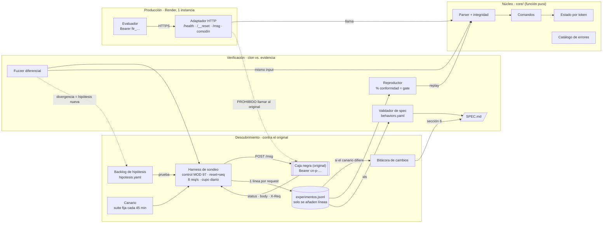

# Arquitectura · Réplica de la Caja Negra

**Reto 2 · Hackathon Frontier** 

## 1. Objetivo

Construir un reemplazo del servicio "caja negra" que responda **exactamente igual** (status HTTP y cuerpo, errores incluidos), acompañado de una especificación verificable y del log de experimentos que la respalda.

Principio: **ingeniería inversa guiada por evidencia**. Cada request al original queda registrado, y cada comportamiento del clon se comprueba contra ese registro antes de desplegarse.

## 2. Restricciones que condicionan la arquitectura

| Restricción del reto | Decisión de arquitectura |
|---|---|
| Cada request al original debe ir al log con su hipótesis | Un único **harness** es el único camino hacia el original |
| Una afirmación falsa en la spec resta puntos | La spec se genera desde un registro y un **validador** exige evidencia real |
| El set le habla a un solo proceso; el estado vive entre requests | **Proceso persistente de una sola instancia** (Render), estado en memoria |
| 5 s por paso | Clon determinista, sin LLM en el camino de respuesta |
| El clon no puede llamar al original (si lo hace, el set vale 0) | Producción no tiene ni la URL ni el token del original |
| El servicio puede cambiar durante el día | **Canario** periódico que detecta divergencias contra la versión vigente |
| 8 000 req/día y 10 req/s por token; un solo token | Limitador a 8 req/s, contador de cupo, **un solo agente** usa el token |

## 3. Diagrama

## 4. Componentes

| Componente | Carril | Responsabilidad | Entrada → Salida |
|---|---|---|---|
| Backlog de hipótesis | Descubrimiento | Lista priorizada de lo que falta probar, por sección de la spec | — → hipótesis y requests a enviar |
| Harness de sondeo | Descubrimiento | Único cliente del original: arma el mensaje, calcula o corrompe el control, hace reset al iniciar una secuencia, limita la tasa y cuenta el cupo | hipótesis + request → línea de log |
| Caja negra | Externo | Servicio original (`https://caja-negra-production-c64f.up.railway.app`) | — |
| `experimentos.jsonl` | Descubrimiento | Fuente de verdad, solo se añaden líneas. Formato del README (`id, seq, x_req, hipotesis, request, status, response, conclusion`) | — |
| Canario | Descubrimiento | Reproduce una suite fija cada 45 min para detectar cambios del servicio | suite → diferencias |
| Bitácora de cambios | Descubrimiento | Qué cambió, desde qué hora y con qué ids se detectó | diferencias del canario → sección 6 |
| Fuzzer diferencial | Verificación | Genera secuencias, las manda al original (vía harness) y al clon, y reporta divergencias | semilla → divergencias |
| Reproductor | Verificación | Re-ejecuta cada secuencia del log contra `core/` y compara | log → % de conformidad (gate de deploy) |
| Validador de spec | Verificación | Comprueba que cada comportamiento cite ids existentes y que el clon los reproduzca | `behaviors.yaml` + log → errores |
| `SPEC.md` | Verificación | Especificación en las 7 secciones del README, generada desde el registro | — |
| `core/` | Núcleo | Lógica completa del servicio como función pura `(estado, request) → (status, body)` | — |
| Adaptador HTTP | Producción | Rutas, autenticación, reset, health, y respuestas exactas para rutas inexistentes | HTTP → `core/` → HTTP |

## 5. Flujos principales

1. **Experimento.** Hipótesis → harness → original → línea en el log → conclusión → actualización de `core/` y de `behaviors.yaml`.
2. **Gate de deploy.** Reproductor sobre todo el log. Solo se despliega si no hay regresiones respecto al deploy anterior.
3. **Request en producción.** Evaluador → adaptador (auth, ruta) → `core/` → respuesta. El estado vive en memoria del proceso y `/__reset` lo reinicia.
4. **Detección de cambios.** Canario → diferencia → bitácora → nuevas hipótesis → ajuste de `core/`. Se evalúa la versión vigente a las 20:00.

## 6. Despliegue

- **Plataforma:** Render Web Service, plan Starter, **1 instancia**, `uvicorn --workers 1`.
- **Variables de entorno:** solo `TEAM_TOKEN` (el `ftr_…`). Producción **no** recibe la URL ni el token del original.
- **Health:** `GET /health` responde 200 cuando el proceso está listo.
- **Deploys:** desde el repositorio, cada vez que el reproductor pasa el gate. Primer deploy temprano para medir con `/evento/resultados`.

## 7. Decisiones de arquitectura

| ID | Decisión | Alternativa descartada | Motivo |
|---|---|---|---|
| AD-1 | Python 3.12 + Starlette/FastAPI en modo crudo | Node + Express | Un solo lenguaje para harness, fuzzer, reproductor y servidor; enteros de precisión arbitraria para el MOD 97 |
| AD-2 | Render (proceso persistente) | Vercel (serverless) | El estado en memoria se pierde entre invocaciones serverless; el reto exige un solo proceso |
| AD-3 | Núcleo como función pura compartido | Lógica escrita dentro de los handlers HTTP | Lo que pasa el replay local es exactamente lo que se despliega |
| AD-4 | Harness como único camino al original | Requests manuales (curl, Postman) | Garantiza un log completo y citable |
| AD-5 | Sin LLM en el clon | LLM que "imite" respuestas | Latencia, respuestas no deterministas; el problema es determinista |
| AD-6 | Spec generada desde un registro validado | Spec redactada a mano | Evita afirmaciones sin evidencia, que restan puntos |
